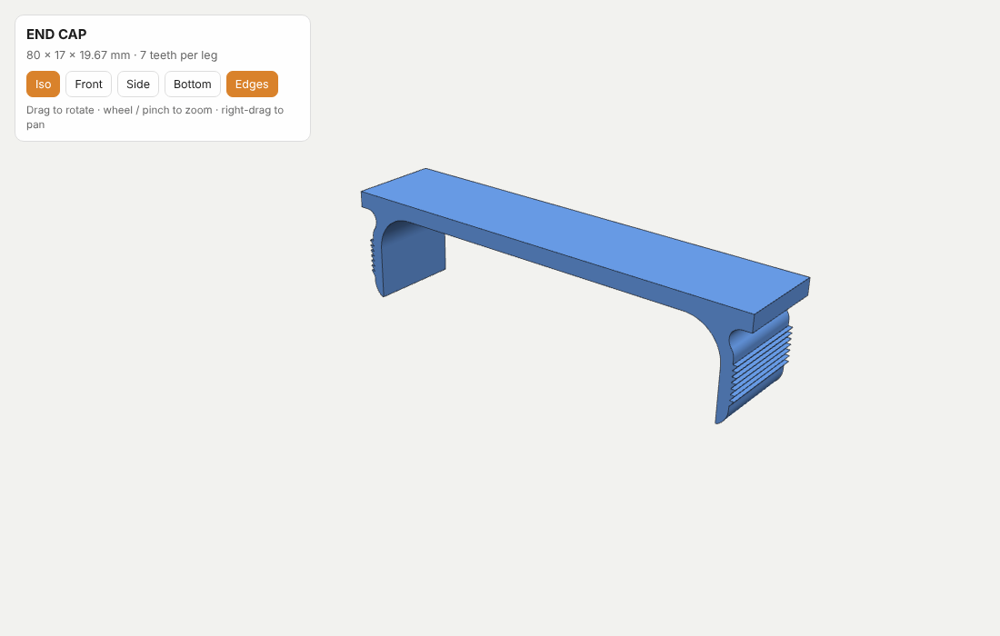

# END CAP (END-CAP-01)

Symmetric snap-in end cap, profile extruded to 17 mm.



| | |
|---|---|
| Overall size | 80 × 17 × 19.67 mm |
| Top plate | 3 mm |
| Leg spacing at plate | 76.8 mm |
| Leg wall | 2 mm |
| Teeth | 7 per leg, pitch 1 mm, height 0.8 mm |
| General tolerances | ISO 2768-m |
| Material | *to be specified* |

## Files

| Path | Purpose |
|---|---|
| `cad/end-cap.step` | 3D solid (true arcs) – tooling / CNC |
| `cad/end-cap.stl` | Mesh – 3D printing |
| `cad/end-cap_profile.dxf` | 2D profile 1:1, mm – extrusion die / laser |
| `drawings/end-cap_drawing.pdf` | Dimensioned production drawing, A3, first-angle projection |
| `docs/index.html` | Interactive 3D viewer (works with GitHub Pages) |
| `scripts/` | Python scripts that regenerate all files |

## Interactive 3D viewer

Open `docs/index.html` in a browser, or enable **GitHub Pages** (Settings → Pages → Branch `main`, folder `/docs`) to get a shareable link.

## Regenerating

```bash
pip install ezdxf shapely matplotlib cadquery numpy
cd scripts
python build_profile.py   # -> cad/end-cap_profile.dxf
python build_3d.py        # -> cad/end-cap.step, cad/end-cap.stl
python build_drawing.py   # -> drawings/end-cap_drawing.pdf
python build_viewer.py    # -> docs/index.html
```

© ULAMEX, Zawada 144
